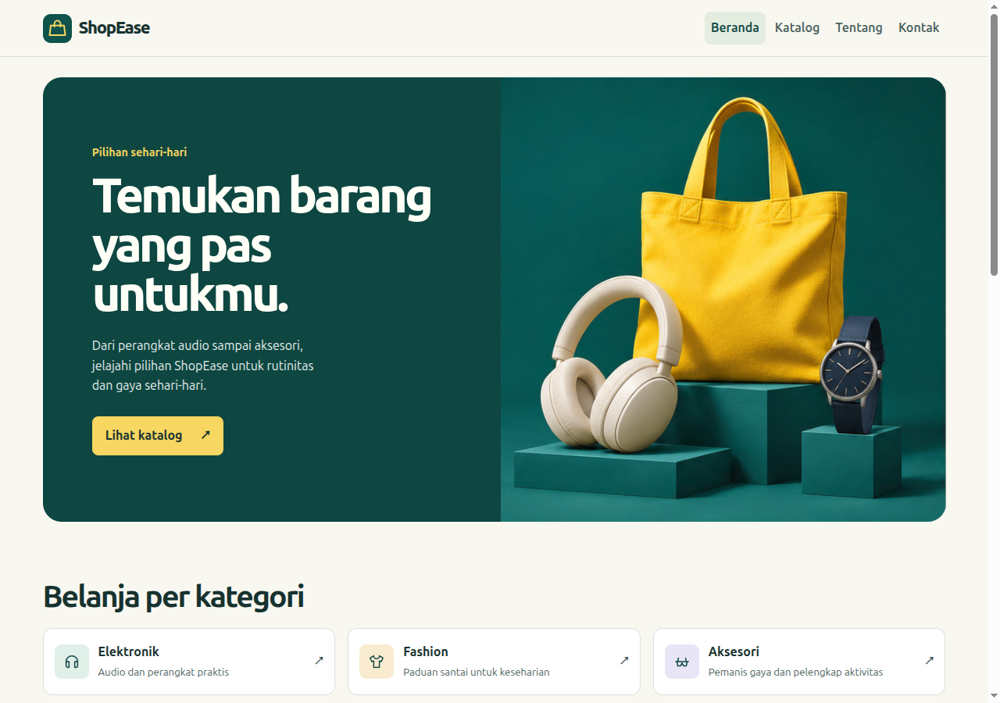
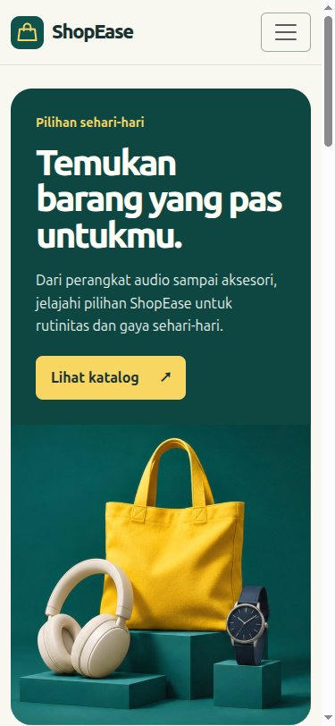
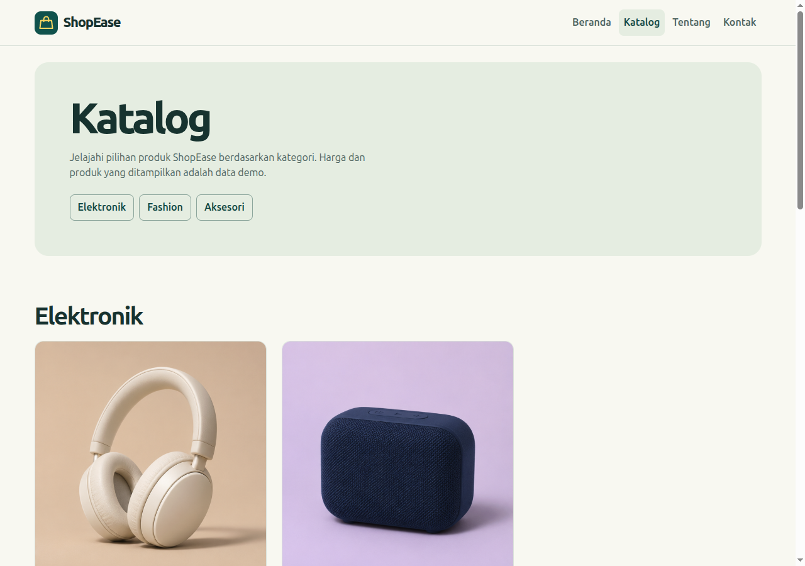
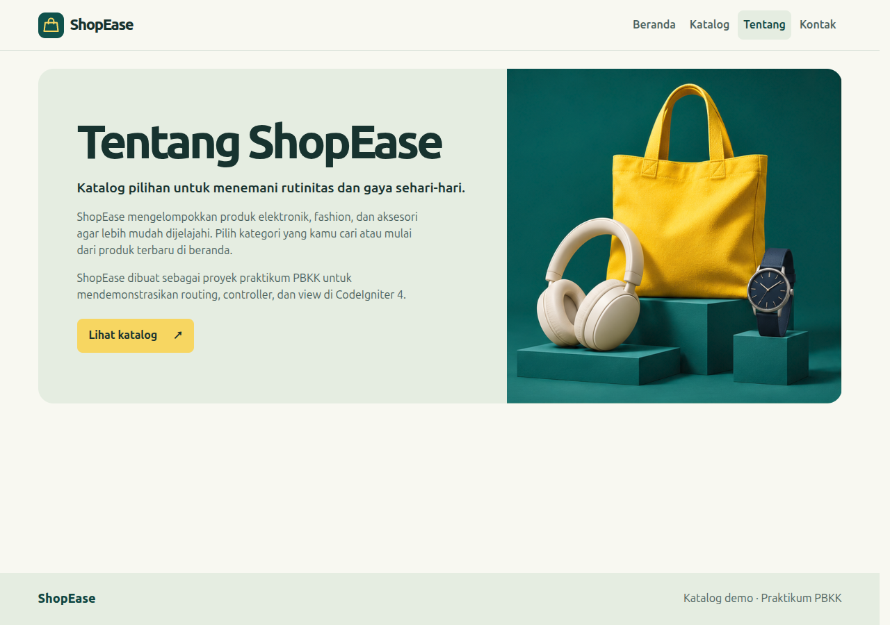
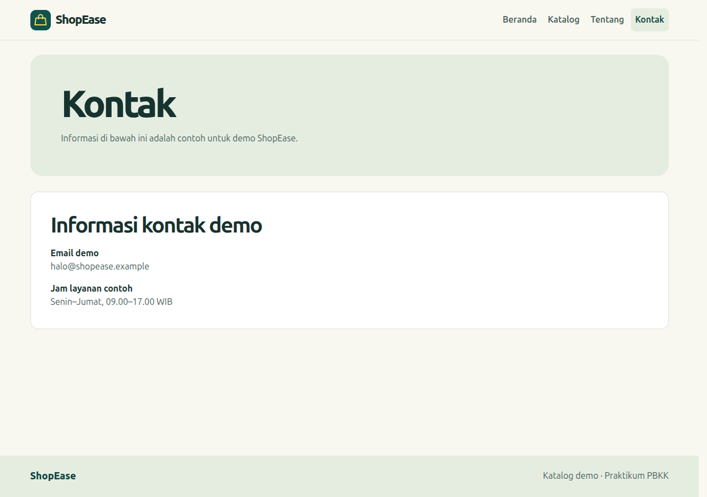

# Laporan Praktikum PBKK · MVC dan Routing CodeIgniter 4 (ShopEase)

**Proyek** · ShopEase, folder `shopease/`

**Materi** · [MVC dan Routing CI, Fajar Baskoro](https://fajarbaskoro.blogspot.com/2021/05/mvc-dan-routing-ci.html) · [Hands-On Lab Praktikum 3](https://docs.google.com/document/d/1UeP6gfr6OMpOmESK3LJFENQwyrL5HnUQ/edit)

**Dokumen terkait** · [Rencana Perangkat Lunak](RENCANA-PERANGKAT-LUNAK.md) · [README](../README.md)

## 1. Deskripsi Hands On

ShopEase adalah prototipe *landing page* dan katalog toko online multi-kategori berbasis CodeIgniter 4 untuk praktikum Pemrograman Berbasis Kerangka Kerja (PBKK). Pengunjung dapat membuka beranda, melihat banner promosi, menjelajahi kategori **Elektronik**, **Fashion**, dan **Aksesori**, melihat sorotan **Produk terbaru** dan **Produk terlaris**, lalu berpindah ke halaman **Katalog**, **Tentang**, dan **Kontak**.

Tahap praktikum ini berfokus pada pemetaan *route* (jalur URL) eksplisit, pemisahan controller dan view, layout bersama, serta antarmuka responsif menggunakan data contoh tanpa database. Modul lanjutan seperti MySQL, CRUD admin, akun pengguna, keranjang, checkout, pembayaran, dan pengiriman masuk ke roadmap pengembangan berikutnya sesuai [PRD ShopEase](https://docs.google.com/document/d/19P2k4LBXTK8nrcvd5j1mvFt-fHhlSdyx/edit).

| Komponen | Implementasi |
| --- | --- |
| Aplikasi | ShopEase · Landing page dan katalog toko online |
| Framework | CodeIgniter 4 (v4.7.6) dengan PHP 8.2 atau lebih baru |
| Sumber data | Data contoh bersama di `app/Config/DemoCatalog.php` (tanpa database) |
| Antarmuka | View PHP, Bootstrap 5.3.9 lokal, CSS khusus (`shop.css`), dan JS fallback gambar (`images.js`) |
| Struktur | Route eksplisit, `HomeController`, `CatalogController`, layout bersama `layouts/store.php`, dan komponen kartu produk |

## 2. Tujuan Pembelajaran

- Memetakan URL publik secara eksplisit di `app/Config/Routes.php` dengan menonaktifkan *auto-routing* (pemetaan URL otomatis ke nama controller).
- Menerapkan pemisahan peran pada pola MVC (*Model–View–Controller*) dari permintaan URL, pengolahan data di controller, hingga rendering HTML di view.
- Menggunakan layout bersama (`$this->extend('layouts/store')`) dan komponen view terpisah agar navigasi, footer, dan kartu produk konsisten di semua halaman.
- Menampilkan data dinamis secara aman menggunakan `esc()` serta membangun tautan internal dengan helper `url_to()` dan `base_url()`.
- Memastikan tampilan responsif di layar desktop dan ponsel, navigasi ramah keyboard, penanganan kondisi data kosong, serta gambar pengganti (*fallback*) lokal.
- Memverifikasi perilaku route, urutan data, dan kondisi batas menggunakan tes fitur otomatis PHPUnit.

## 3. Arsitektur dan Alur Proses

### A. Alur Permintaan URL → Route → Controller → View

1. Pengunjung membuka `GET /`. `app/Config/Routes.php` mencocokkan `/` ke `HomeController::index` dengan nama route `home`.
2. `HomeController::index()` memuat data dari `config(DemoCatalog::class)`, mengurutkan produk terbaru dan terlaris, lalu meneruskan `categories`, `latest`, dan `bestsellers` ke view `frontend/home`.
3. `app/Views/frontend/home.php` mewarisi `app/Views/layouts/store.php` (navbar, tautan lompat ke konten, Bootstrap lokal, dan footer) serta merender kartu produk lewat `app/Views/components/product_grid.php` dan `app/Views/components/photo.php`.
4. Pola yang sama berlaku untuk `GET /katalog` (`CatalogController::index` → `frontend/catalog`), `GET /about` (`HomeController::about` → `frontend/about`), dan `GET /contact` (`HomeController::contact` → `frontend/contact`).

### B. Pengurutan Produk dan Tautan Kategori

1. Pada beranda, `HomeController::index()` menyusun **Produk terbaru** berdasarkan tanggal `addedOn` terbaru dan **Produk terlaris** berdasarkan jumlah `sold` tertinggi, masing-masing dibatasi 3 item teratas. Jika nilainya seri, urutan ditentukan menurut nama produk secara alfabetis (`strcasecmp`).
2. Pada halaman katalog, `CatalogController::index()` mengelompokkan seluruh produk berdasarkan *slug* kategori (`elektronik`, `fashion`, `aksesori`).
3. Kartu kategori di beranda menaut ke `/katalog#elektronik`, `/katalog#fashion`, dan `/katalog#aksesori`, yang langsung menuju bagian `<section id="...">` yang sesuai di halaman katalog.

### C. Penanganan Gambar Gagal Muat, Kondisi Kosong, dan 404

1. Jika berkas foto produk tidak tersedia di server, komponen `photo.php` langsung merender `public/assets/images/placeholder.svg` dengan kelas `photo--missing`.
2. Jika foto gagal dimuat di browser saat *runtime*, `public/assets/images.js` menangkap *event* `error`, menghapus kelas posisi bingkai (`photo--framed`, `photo--top-left`, `photo--top-right`, `photo--bottom-left`, `photo--bottom-right`), menambahkan `photo--missing`, lalu mengganti sumber gambar ke `placeholder.svg`.
3. Jika daftar produk atau kategori kosong, halaman menampilkan pesan singkat yang informatif tanpa memutus navigasi utama.
4. Permintaan ke URL yang tidak terdaftar maupun akses langsung ke nama controller (misalnya `/HomeController/index`) mengembalikan respons HTTP `404`.

## 4. Sumber Data Contoh dan Pemodelan

Pada tahap praktikum ini, `app/Config/DemoCatalog.php` berperan sebagai sumber data tunggal sementara pengganti database dan Model. Pendekatan ini memungkinkan demo alur routing–controller–view langsung berjalan tanpa menyiapkan MySQL, sekaligus menjamin nama, kategori, dan harga produk di Beranda dan Katalog selalu sama. Saat masuk fase database, controller cukup beralih dari `DemoCatalog` ke Model CodeIgniter 4.

### Kategori Contoh

| Slug | Nama | Deskripsi |
| --- | --- | --- |
| `elektronik` | Elektronik | Audio dan perangkat praktis |
| `fashion` | Fashion | Paduan santai untuk keseharian |
| `aksesori` | Aksesori | Pemanis gaya dan pelengkap aktivitas |

### Daftar Produk Contoh

Seluruh harga, tanggal penambahan, dan angka penjualan di bawah ini merupakan data demo:

| ID Produk | Nama | Kategori | Harga | Tanggal Tambah | Terjual (Demo) |
| --- | --- | --- | --- | --- | --- |
| `headphone-studio` | Headphone Studio | Elektronik | Rp429.000 | 2026-11-22 | 58 |
| `speaker-mini` | Speaker Mini | Elektronik | Rp249.000 | 2026-11-09 | 86 |
| `tote-kanvas` | Tote Kanvas | Fashion | Rp129.000 | 2026-11-20 | 102 |
| `topi-weekend` | Topi Weekend | Fashion | Rp89.000 | 2026-11-14 | 39 |
| `jam-tempo` | Jam Pintar Tempo | Aksesori | Rp549.000 | 2026-11-18 | 47 |
| `kacamata-senja` | Kacamata Senja | Aksesori | Rp159.000 | 2026-11-12 | 73 |
| `pouch-rute` | Pouch Rute | Aksesori | Rp79.000 | 2026-11-10 | 31 |

Dari data tersebut, beranda otomatis menampilkan **Produk terbaru**: Headphone Studio, Tote Kanvas, Jam Pintar Tempo; serta **Produk terlaris**: Tote Kanvas, Speaker Mini, Kacamata Senja.

## 5. Struktur Folder dan Route Utama

| Lokasi | Isi |
| --- | --- |
| `app/Config/Routes.php`, `app/Config/Routing.php` | Pemetaan 4 route GET eksplisit dan pengaturan `$autoRoute = false` |
| `app/Config/DemoCatalog.php` | Sumber data kategori dan 7 produk contoh bersama |
| `app/Controllers/HomeController.php`, `CatalogController.php` | Controller untuk beranda, katalog, tentang, dan kontak |
| `app/Views/layouts/store.php` | Layout bersama (header, navbar responsif, skip-link, footer) |
| `app/Views/frontend/` | View halaman `home.php`, `catalog.php`, `about.php`, dan `contact.php` |
| `app/Views/components/` | Komponen `product_grid.php`, `photo.php`, dan `category_icon.php` |
| `public/assets/` | Bootstrap 5.3.9 lokal, `shop.css`, `images.js`, ikon, foto produk, dan `placeholder.svg` |
| `tests/feature/CatalogPagesTest.php` | Tes fitur route, auto-routing, urutan produk, tautan kategori, data kosong, dan fallback gambar |
| `docs/` | `RENCANA-PERANGKAT-LUNAK.md`, `LAPORAN.md`, dan tangkapan layar `gambar/` |

| Metode dan URL | Nama Route | Controller | View |
| --- | --- | --- | --- |
| `GET /` | `home` | `HomeController::index` | `frontend/home` |
| `GET /katalog` | `catalog` | `CatalogController::index` | `frontend/catalog` |
| `GET /about` | `about` | `HomeController::about` | `frontend/about` |
| `GET /contact` | `contact` | `HomeController::contact` | `frontend/contact` |

## 6. Panduan Instalasi dan Menjalankan Demo

Siapkan PHP 8.2 atau lebih baru dengan ekstensi `intl` dan `mbstring`, serta Composer. Untuk menjalankan PHPUnit, aktifkan pula ekstensi XML PHP (`dom` dan `xmlwriter`). Jalankan perintah berikut dari folder `shopease/`:

```bash
composer install
php spark serve --host localhost --port 8081
```

Buka [http://localhost:8081/](http://localhost:8081/). Port `8081` digunakan agar tidak bentrok dengan proyek Shopify di port `8080`, sesuai `app.baseURL` bawaan di `app/Config/App.php`. Jika ingin memakai port lain, salin `env` ke `.env`, ubah `app.baseURL`, lalu jalankan `php spark serve` pada port yang sama. Seluruh aset (Bootstrap 5.3.9, ikon, dan gambar) disajikan lokal dari `public/assets/`, sehingga demo berjalan tanpa bergantung pada CDN luar.

## 7. Skenario dan Hasil Pengujian

Pengujian dilakukan menggunakan CLI CodeIgniter, PHPUnit, pemeriksaan HTTP langsung ke server lokal `localhost:8081`, serta pengujian tampilan dan *fallback* di browser Chromium.

| Skenario | Hasil yang diamati | Status |
| --- | --- | --- |
| Empat route publik dan 404 | `/`, `/katalog`, `/about`, `/contact` mengembalikan HTTP `200`; `/tidak-ada` dan `/HomeController/index` mengembalikan `404` | Lulus |
| Produk terbaru, terlaris, dan konsistensi data | Urutan sesuai `addedOn`, `sold`, dan tie-break alfabetis; nama dan harga di beranda cocok dengan katalog | Lulus |
| Navigasi kategori ke katalog | Tautan `#elektronik`, `#fashion`, dan `#aksesori` di beranda cocok dengan `section` di `/katalog` | Lulus |
| Penanganan data kosong | Ketika produk atau kategori dikosongkan, pesan kosong tampil dan navigasi tetap berfungsi | Lulus |
| Gambar pengganti (server & browser) | Berkas foto hilang menampilkan `placeholder.svg`; gagal muat di browser pada kartu `top-right` (`headphone-studio`) beralih ke `photo--missing` dengan posisi sejajar penuh dalam kotak | Lulus |
| Tampilan responsif & aksesibilitas | Tampilan 1.280 px dan 375 px rapi tanpa gulir horizontal; skip-link, tombol katalog, dan menu ponsel dapat diakses lewat keyboard | Lulus |

Perintah verifikasi otomatis:

```bash
php spark routes
vendor/bin/phpunit --no-coverage
```

**Hasil PHPUnit** · **11 tes dan 41 asersi lulus** (`OK`), termasuk 6 tes fitur pada `tests/feature/CatalogPagesTest.php`.

**Catatan review dan perbaikan:** Pada tahap review kode ditemukan bug pada aturan posisi bingkai di `public/assets/shop.css` dan penggantian kelas di `public/assets/images.js` yang dapat membuat `placeholder.svg` tergeser keluar kotak pada kartu berposisi non-kiri-atas saat gambar gagal dimuat di browser. Aturan offset telah dibatasi hanya pada `.photo--framed`, kelas posisi bingkai dibersihkan saat *fallback* aktif, dan perbaikan telah diverifikasi langsung di Chromium.

## 8. Tahapan Pengembangan dan Checklist Keberhasilan

| Target sesuai materi & rencana | Bukti pada aplikasi | Status |
| --- | --- | --- |
| Dokumen Rencana Perangkat Lunak | `docs/RENCANA-PERANGKAT-LUNAK.md` mencakup ruang lingkup praktikum dan roadmap PRD lengkap | Selesai |
| Landing page ShopEase | Banner, tombol **Lihat katalog**, 3 kategori, produk terbaru, dan produk terlaris di `/` | Selesai |
| Modifikasi routing, controller, dan view | 4 route GET eksplisit, 2 controller terpisah, layout bersama, dan komponen kartu produk | Selesai |
| Halaman About dan Contact (HOL Praktikum 3) | `/about` dan `/contact` dengan label informasi kontak demo yang jelas | Selesai |
| Katalog baca-saja & tampilan responsif | `/katalog` menampilkan 7 produk per kategori; diuji pada lebar 1.280 px dan 375 px | Selesai |
| Pengujian & dokumentasi laporan | 11 tes PHPUnit (41 asersi), verifikasi HTTP/browser, README, dan laporan ini | Selesai |

**Roadmap lanjutan (di luar cakupan praktikum ini):** migrasi ke MySQL dan CRUD produk admin, autentikasi dan peran pengguna, keranjang serta checkout, verifikasi pembayaran manual dan pengiriman, hingga dashboard laporan penjualan.

## 9. Catatan Keamanan, Aksesibilitas, dan Implementasi

- *Auto-routing* dinonaktifkan (`$autoRoute = false` pada `app/Config/Routing.php`) sehingga hanya 4 route eksplisit yang dapat diakses publik.
- Seluruh nilai dinamis di layout, view, dan komponen dilewatkan melalui `esc()` / `esc(..., 'attr')` untuk mencegah XSS (*Cross-Site Scripting*), dan tautan internal memakai `url_to()` serta `base_url()`.
- Halaman menyediakan tautan `Lewati ke konten` (*skip-link*), atribut `aria-current="page"` pada menu aktif, dan dukungan fokus keyboard pada menu ponsel maupun tombol utama.
- Informasi kontak di `/contact` (`halo@shopease.example`) serta data harga/penjualan diberi label jelas sebagai data demo.
- Folder `app/Models/` masih kosong sesuai rancangan tahap tanpa database, dan berkas bawaan framework `app/Controllers/Home.php` serta `app/Views/welcome_message.php` tidak terpasang di `Routes.php`.

## 10. Hasil Implementasi

Seluruh produk, harga, dan kontak pada tangkapan layar di bawah ini merupakan data contoh untuk demo praktikum.

### Beranda (Desktop)



### Beranda (Ponsel)



### Katalog Produk



### Halaman Tentang



### Halaman Kontak


