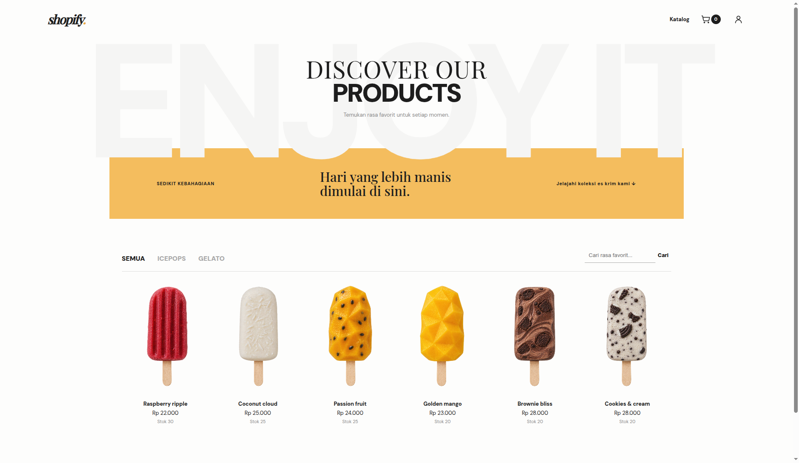
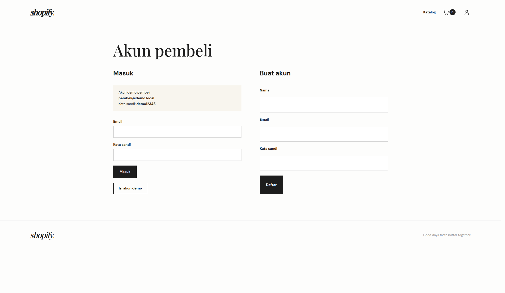
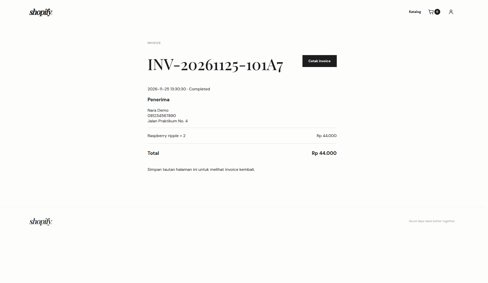
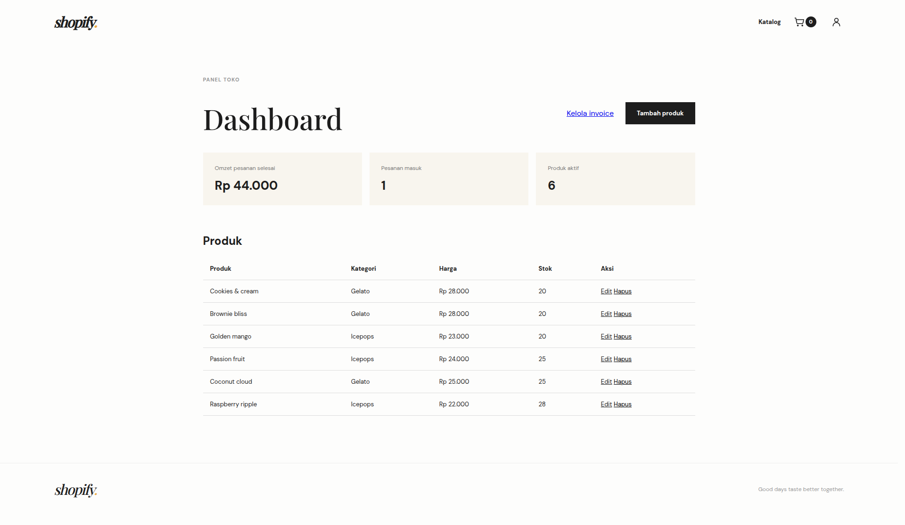
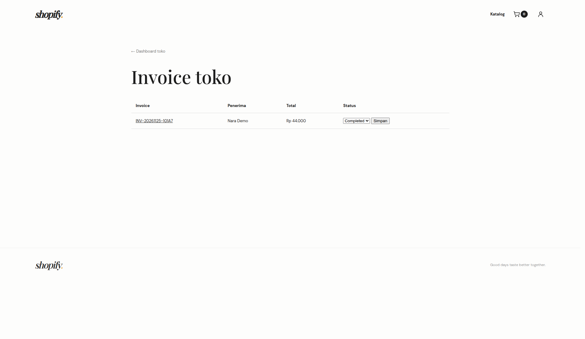

# Laporan Praktikum PBKK · Toko Online Es Krim

**Proyek** · Shopify, folder `shopify/`

**Materi** · [CRUD – Toko Online, Fajar Baskoro](https://fajarbaskoro.blogspot.com/2021/06/crud-toko-online.html)

## 1. Deskripsi Hands On

Shopify adalah toko es krim sederhana dengan katalog Icepops dan Gelato. Pembeli bisa membuat akun, menambahkan produk ke keranjang, membuat pesanan, dan membuka invoice. Admin bisa mengelola produk dan memperbarui status pesanan. Invoice merangkum transaksi untuk praktikum. Pembayaran daring dan integrasi kurir berada di luar cakupan demo ini.

| Komponen | Implementasi |
| --- | --- |
| Aplikasi | Shopify · Toko es krim |
| Framework | CodeIgniter 4 dengan PHP 8.2 atau lebih baru |
| Database | SQLite sebagai bawaan. MySQL tersedia lewat `shop.sql`. |
| Antarmuka | HTML dari view PHP dan CSS khusus |
| Struktur | Route, controller, view, dan pustaka data `ShopStore` |

## 2. Tujuan Pembelajaran

- Membuat katalog dinamis dan menerapkan CRUD, yaitu menambah, menampilkan, mengubah, dan menghapus produk dari katalog.
- Memvalidasi registrasi dan login, menyimpan hash kata sandi pembeli, dan mengelola sesi masuk serta keluar.
- Menghubungkan keranjang dengan data harga dan stok terbaru di server.
- Membuat pesanan dan invoice melalui transaksi database.
- Membatasi akses pengelolaan produk dan invoice untuk admin.

## 3. Arsitektur dan Alur Proses

### A. Registrasi, Login, dan Logout

1. Pembeli membuka `/account`, lalu mengisi nama, email, dan kata sandi minimal delapan karakter.
2. Controller memvalidasi input dan menyimpan akun dengan `password_hash()`. Database menolak email duplikat.
3. Saat login, `password_verify()` memeriksa kata sandi. Aplikasi mengganti ID sesi, menyimpan ID dan nama pembeli, lalu membuka riwayat pesanan.
4. Tombol keluar menghapus identitas pembeli dari sesi dan mengganti ID sesi. Akses ke riwayat lalu mengarahkan pengguna kembali ke halaman akun.

### B. Keranjang, Checkout, dan Invoice Pembeli

1. Pembeli memilih produk dari katalog dan menentukan jumlah sesuai stok. Keranjang disimpan dalam sesi.
2. Saat checkout, pembeli memasukkan nama penerima, nomor WhatsApp, dan alamat. Pembeli juga dapat membuat pesanan sebagai tamu.
3. `ShopStore` memeriksa stok dan menghitung total dari harga di database. Satu transaksi database menyimpan pesanan beserta rincian, lalu mengurangi stok. Jika proses gagal, transaksi dibatalkan.
4. Aplikasi mengosongkan keranjang setelah pesanan tersimpan dan membuka invoice. Pembeli terdaftar bisa membukanya dari riwayat. Tamu bisa kembali lewat tautan invoice yang berisi token akses.

### C. Produk dan Invoice Admin

1. Admin masuk melalui `/login`. Panel produk menampilkan produk aktif, jumlah pesanan, dan omzet dari pesanan berstatus `Completed`.
2. Admin bisa menambah, mengedit, dan menghapus produk. Penghapusan menonaktifkan produk sehingga katalog menyembunyikannya dan riwayat transaksi tetap tersedia.
3. Di halaman **Invoice toko**, admin membuka detail transaksi atau memilih status `Pending`, `Processing`, `Completed`, atau `Cancelled`. Pembeli melihat status terbaru di riwayat dan invoice. Pembatalan oleh admin tidak menambah stok secara otomatis.

## 4. Struktur Database

SQLite menyimpan data di `writable/shop.db`. Aplikasi membuat tabel dan data contoh saat pertama digunakan.

| Tabel | Kolom utama | Fungsi |
| --- | --- | --- |
| `customers` | `id`, `name`, `email` (unik), `password_hash` | Akun pembeli |
| `products` | `id`, `name`, `description`, `category`, `price`, `stock`, `image`, `active` | Katalog, harga rupiah bulat, stok, dan status aktif |
| `orders` | `id`, `invoice` (unik), `customer_id`, `recipient`, `whatsapp`, `address`, `total`, `status`, `created_at`, `access_token` | Data penerima, total, status, dan akses invoice |
| `order_items` | `id`, `order_id`, `product_id`, `product_name`, `price`, `quantity` | Produk, harga, dan jumlah pada saat pemesanan |

Satu pembeli dapat memiliki banyak pesanan. Satu pesanan dapat berisi banyak item. `customer_id` kosong untuk pesanan tamu. Kredensial admin demo berada di `app/Config/DemoAdmin.php`.

## 5. Struktur Folder dan Route Utama

| Lokasi | Isi |
| --- | --- |
| `app/Config/Routes.php`, `app/Config/Filters.php` | Pemetaan route dan perlindungan CSRF |
| `app/Controllers/` | `Home` dan `Shop` untuk toko. `ShopAdminAuth` untuk login dan logout admin. |
| `app/Libraries/ShopStore.php` | Koneksi PDO, inisialisasi database, dan transaksi checkout |
| `app/Views/`, `public/assets/showcase/` | Tampilan toko, login admin, CSS, dan aset produk |
| `tests/unit/ShopStoreTest.php` | Tes unit penyimpanan akun dan transaksi |

| Fungsi | Metode dan URL | Akses |
| --- | --- | --- |
| Katalog dan detail | `GET /`, `GET /product/{id}` | Publik |
| Form akun, profil, dan riwayat | `GET /account`, `GET /profile`, `GET /orders` | Profil dan riwayat khusus pembeli yang sudah login |
| Registrasi, login, dan logout pembeli | `POST /account/register`, `POST /account/login`, `POST /account/logout` | Sesi pembeli |
| Keranjang | `GET /cart`, `POST /cart/add/{id}`, `POST /cart/update` | Sesi belanja |
| Checkout dan detail invoice | `GET /checkout`, `POST /checkout`, `GET /invoice/{nomor}` | Invoice memerlukan sesi pemilik/admin atau token akses |
| Login dan logout admin | `GET /login`, `POST /login`, `POST /admin/logout` | Sesi admin |
| Panel dan form produk | `GET /admin/shop`, `GET /admin/shop/products/new`, `GET /admin/shop/products/{id}/edit` | Admin |
| Tambah, ubah, dan hapus produk | `POST /admin/shop/products`, `POST /admin/shop/products/{id}`, `POST /admin/shop/products/{id}/delete` | Admin |
| Daftar invoice dan perubahan status | `GET /admin/shop/invoices`, `POST /admin/shop/orders/{id}/status` | Admin |

## 6. Panduan Instalasi dan Akun Pengujian

Siapkan PHP 8.2 atau lebih baru dengan ekstensi `intl`, `mbstring`, `pdo_sqlite`, dan `fileinfo`, serta Composer. Jalankan perintah berikut dari folder `shopify`.

```bash
composer install
php spark serve
```

Buka [localhost:8080](http://localhost:8080). Pada pemakaian pertama, katalog menampilkan enam produk contoh. Folder `writable` dan `public/uploads/products` perlu bisa ditulis oleh server.

| Peran | Halaman masuk | Email demo | Kata sandi demo |
| --- | --- | --- | --- |
| Pembeli | `/account` | `pembeli@demo.local` | `demo12345` |
| Admin | `/login` | `admin@demo.local` | `admin12345` |

## 7. Skenario dan Hasil Pengujian

Pengujian alur menggunakan server lokal dan database SQLite khusus pengujian.

| Skenario | Hasil yang diamati | Status |
| --- | --- | --- |
| Katalog, pencarian, dan kategori | Pencarian mangga dan filter Gelato menampilkan produk yang sesuai | Lulus |
| Autentikasi pembeli | Registrasi berhasil, email duplikat dan kata sandi salah ditolak, riwayat meminta login kembali setelah logout | Lulus |
| Keranjang dan pesanan | Jumlah melebihi stok ditolak. Dua Raspberry ripple menghasilkan invoice Rp 44.000 dan mengurangi stok dua unit. | Lulus |
| Akses invoice | Pembeli melihat invoice di riwayat. Pengunjung memerlukan tautan bertoken untuk invoice tersebut. | Lulus |
| CRUD produk admin | Produk baru tampil, perubahan harga terbaca, produk yang dihapus hilang dari katalog | Lulus |
| Invoice dan sesi admin | Status baru tampil pada invoice pembeli. Status tidak valid ditolak dan panel tertutup setelah logout. | Lulus |

```bash
vendor/bin/phpunit --no-coverage
```

**Hasil PHPUnit** · 3 tes dan 10 asersi lulus. Tes memeriksa hash kata sandi akun demo, penyimpanan invoice dan pengurangan stok, serta kondisi ketika stok tidak mencukupi.

## 8. Tahapan Pengembangan dan Checklist Keberhasilan

| Modul sesuai materi | Bukti pada aplikasi | Status |
| --- | --- | --- |
| Halaman utama toko online | Katalog, pencarian, filter, dan detail produk | Selesai |
| Register dan login member | Form masuk dan daftar di halaman akun | Selesai |
| Order member | Keranjang, checkout, riwayat, dan invoice | Selesai |
| Logout session | Keluar dari akun pembeli dan admin | Selesai |
| Halaman admin produk | Daftar, tambah, edit, dan hapus produk | Selesai |
| Halaman admin invoice | Daftar, detail, dan perubahan status invoice | Selesai |

## 9. Catatan Keamanan dan Implementasi

- Form yang mengubah data memakai token CSRF dan route `POST`.
- Kata sandi pembeli disimpan sebagai hash. ID sesi diganti saat login dan logout.
- Controller memeriksa sesi admin sebelum membuka panel atau menulis perubahan.
- Tautan invoice tamu memberikan akses kepada pemegang tautan. Bagikan hanya kepada penerima yang berhak.
- Kredensial demo sengaja tampil di halaman masuk untuk praktikum lokal. Kredensial tersebut perlu dihapus atau diganti sebelum situs dibuka untuk umum.

## 10. Hasil Implementasi

Data transaksi pada tangkapan layar merupakan data contoh pengujian.

### Katalog



### Registrasi dan Login Pembeli



### Invoice Pembeli



### Panel Admin Produk



### Panel Admin Invoice


